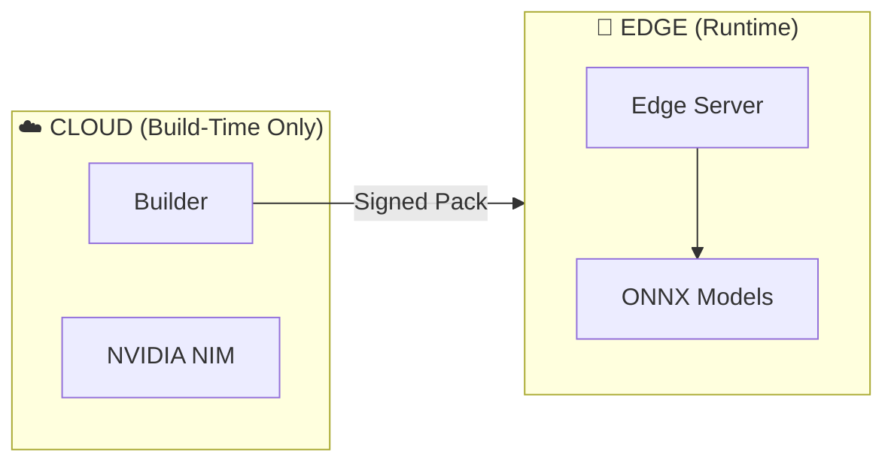

# CMES-AI: Offline Clinical Reference Assistant

> **Mission:** Offline-first clinical reference assistant for field health workers in low-connectivity regions. Every answer cites its source or honestly says "not found".

[]()
[]()
[]()

---

## 📋 Project Overview

CMES-AI is a **phased migration** of the TWB v1.1 prototype ([offline-medical-qa](https://github.com/sai009/offline-medical-qa)) into a production-ready, team-maintainable codebase.

**Current Status:** Phase 0 complete (Problem Statement). Phases 1–10 planned.

### Architecture at a Glance



- **Cloud (build-time):** PDF ingestion → NIM enrichment/embedding → SQLite pack + Ed25519 signing
- **Edge (runtime):** Stdlib HTTP server, FTS5+HNSW search, ONNX rerank, SSE streaming, signed atomic updates
- **Zero cloud at runtime** — works fully offline

---

## 🗓️ Phase Tracker

| Phase | Title | Status | Owner | Docs | Target |
|-------|-------|--------|-------|------|--------|
| **0** | **Problem Statement** | ✅ **Done** | Product + Clinical | [`docs/00-problem-statement.md`](docs/00-problem-statement.md) | Week 1 |
| **1** | Architecture & Contracts | 🔄 Planned | Tech Lead | `docs/01-architecture-decisions.md`, `spec/` | Week 2 |
| **2** | Ingestion Pipeline | 🔄 Planned | Backend | `src/ingest/` | Week 3 |
| **3** | Enrichment Pipeline | 🔄 Planned | Backend | `src/enrich/` | Week 3 |
| **4** | Indexing & Packing | 🔄 Planned | Backend | `src/indexer/` | Week 4 |
| **5** | Edge Runtime | 🔄 Planned | Backend/Embedded | `src/edge/` | Week 4 |
| **6** | Evaluation Gates | 🔄 Planned | ML/QA | `src/eval/` | Week 4 |
| **7** | Test Console (UI) | 🔄 Planned | Frontend | `src/ui/` | Week 4 |
| **8** | Benchmarks & Hardware | 🔄 Planned | Embedded | `benchmarks/` | Week 6–10 |
| **9** | CI/CD & Release Engineering | 🔄 Planned | DevOps | `.github/workflows/` | Week 6–8 |
| **10** | Clinical Validation | 🔄 Planned | Clinical | `golden/` | Week 4–12 |

> **Legend:** ✅ Done | 🔄 In Progress | ⏳ Planned | ❌ Blocked

---

## 📁 Repository Structure

```
CMES-AI/
├── docs/                    # Phase documentation
│   ├── 00-problem-statement.md      # ✅ Phase 0
│   ├── 01-architecture-decisions.md # Phase 1 (ADR log)
│   ├── 02-requirements.md           # Phase 1
│   ├── 03-safety-rules.md           # Phase 1
│   └── 04-production-readiness.md   # Phase 9+
├── spec/                    # Frozen contracts (Phase 1)
│   ├── openapi.yaml               # API contract
│   ├── pack-format.md             # SQLite schema + manifest
│   ├── gate-definitions.md        # 8 gates spec
│   └── model-manifest.md          # Model pinning + upgrade
├── src/                     # Implementation (Phases 2-7)
│   ├── ingest/                    # Stage 1: PDF → chunks (zero LLM)
│   ├── enrich/                    # Stage 2: NIM enrichment (optional)
│   ├── indexer/                   # Stage 3: SQLite + vectors + signing
│   ├── edge/                      # Runtime: search→rerank→verify→SSE
│   ├── eval/                      # 8 fail-closed gates
│   ├── pipeline/                  # Orchestrator
│   ├── common/                    # Shared: NIM client, units, offline backends
│   └── ui/                        # Test console (/ui/)
├── tests/                   # Test suites
│   ├── unit/
│   ├── integration/
│   ├── contract/
│   └── ui-smoke/
├── benchmarks/              # Hardware benchmarks (Phase 8)
├── scripts/                 # Automation
│   ├── setup.sh / setup.ps1       # Cross-platform setup
│   ├── build-pack.sh
│   ├── export-onnx.sh
│   └── run-gates.sh
├── golden/                  # Clinician golden set (Phase 10)
├── samplefiles/             # Source PDFs (gitignored, download script)
├── keys/                    # Ed25519 keys (gitignored, key ceremony docs)
└── .github/workflows/       # CI/CD (Phase 9)
```

---

## 🚀 Quick Start

### Prerequisites
- Python 3.11+
- Node.js 18+ (for UI smoke tests)
- NVIDIA API key (optional, for live NIM builds) — get at [build.nvidia.com](https://build.nvidia.com)

### Setup (All Platforms)
```bash
# macOS / Linux
./scripts/setup.sh

# Windows PowerShell
.\scripts\setup.ps1

# Windows CMD
scripts\setup.bat
```

The interactive setup guides you through:
1. Role selection (Builder / Edge Device / Client / All-in-One)
2. Python check → virtual environment → requirements
3. NVIDIA API key (optional)
4. Signing keys (auto-generated dev keys)
5. ONNX export (optional, requires GPU)

### Run Tests
```bash
# Unit tests (31 tests)
python -m unittest tests.unit -v

# UI smoke tests (requires edge server on :8080)
node tests/ui-smoke/index.mjs
```

---

## 🔑 Key Design Decisions

| Decision | Rationale |
|----------|-----------|
| **Offline-first** | Field workers have no reliable internet |
| **Build-time NIM only** | Edge runs ONNX exports; no cloud calls at runtime |
| **Zero LLM in ingest** | Deterministic, auditable, no hallucination risk |
| **Table-first retrieval** | One chunk per table; cell-level highlights (critical for dosing) |
| **Fail-closed gates** | `not_run = fail`; release requires explicit pass |
| **Signed atomic updates** | Root→CI Ed25519 chain; instant rollback |
| **stdlib HTTP server** | No framework dependencies; minimal attack surface |

---

## 📚 Documentation Index

| Document | Phase | Purpose |
|----------|-------|---------|
| [Problem Statement](docs/00-problem-statement.md) | 0 | Clinical problem, users, constraints, success criteria, architecture diagrams |
| [Architecture Decisions](docs/01-architecture-decisions.md) | 1 | ADR log, frozen contracts |
| [Requirements](docs/02-requirements.md) | 1 | Functional + non-functional requirements |
| [Safety Rules](docs/03-safety-rules.md) | 1 | 8 non-negotiable safety rules |
| [Production Readiness](docs/04-production-readiness.md) | 9+ | Gaps, pilot criteria, Go/No-Go |
| [Phased Migration Plan](../PHASED_MIGRATION_PLAN.md) | — | Full 10-phase plan with timelines |

---

## 🧪 Testing Status

| Suite | Tests | Status |
|-------|-------|--------|
| Unit (core) | 27 | ✅ Passing |
| NIM Mock | 4 | ✅ Passing |
| UI Smoke | 12 | ✅ Passing |
| **Total** | **31** | **✅ 31/31** |

*Tests run against TWB v1.1 prototype. Will be ported to `src/` structure in Phases 2–7.*

---

## 🛣️ Roadmap

```
Phase 0 ──────► Phase 1 ──────► Phases 2-7 ──────► Phase 8/9 ──────► Phase 10 ──────► Pilot
  ✅              🔄              🔄                  ⏳               ⏳              📅
Problem         Contracts       Implementation      Infra + HW      Clinical      Field
Statement       Frozen          (copy from TWB)     CI/CD           Validation    Pilot
```

**Critical Path:** Clinical recruitment (Phase 10) + Hardware procurement (Phase 8) — start Day 1.

---

## 🤝 Contributing

1. Read the [Phased Migration Plan](PHASED_MIGRATION_PLAN.md)
2. Pick a phase from the tracker above
3. Follow [Agent Handoff Instructions](PHASED_MIGRATION_PLAN.md#agent-handoff-instructions)
4. Open PR: `Phase N: <title>`
5. Update this README's phase tracker on merge

---

## 📄 License

Apache 2.0 — see [LICENSE](LICENSE) (to be added in Phase 1)

---

## 🔗 Source Reference

- **Prototype:** [offline-medical-qa@9e5f42d](https://github.com/sai009/offline-medical-qa/commit/9e5f42d) (TWB v1.1)
- **Architecture Spec:** [ARCHITECTURE.md](https://github.com/sai009/offline-medical-qa/blob/main/ARCHITECTURE.md)
- **Handoff Doc:** [HANDOFF_DOCUMENTATION.md](https://github.com/sai009/offline-medical-qa/blob/main/HANDOFF_DOCUMENTATION.md)

---

*Last updated: Phase 0 complete — Problem Statement with Mermaid architecture diagrams committed.*